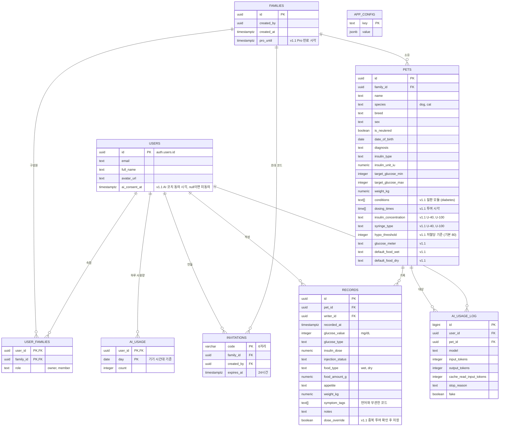

# Mettie App

반려동물 건강/당뇨 관리 애플리케이션입니다. 여러 마리의 반려동물을 다양한 가족 구성원(파트너)과 유연하게 공유할 수 있는 다중 사용자(Multi-tenant) 기반 아키텍처를 채택하고 있습니다.

## v1.1.0 업데이트

버전 `1.1.0+13`. 강아지·고양이 공용 건강 플랫폼으로 넓히기 위한 화면 개편, 가족 간 안전장치, AI 코치의 Claude API 전환, 다국어 지원이 핵심입니다.

### 1. 화면 구조 개편

하단 탭을 역할별로 나눴습니다: **홈(오늘) · 추이 · [+ 기록] · AI 코치 · 건강수첩**. 계정·앱 설정은 각 탭 오른쪽 위 톱니로 옮겼습니다.

- **홈**: 다음 투여 시각과 남은 시간, 가족 중 누가 언제 투여했는지("엄마가 07:02에 2.0 IU 투여 완료"), 놓친 회차, 최신 혈당과 48시간 그래프, 오늘 기록, 체중 변화율. 최근 저혈당이면 맨 위에 응급 대처 카드가 뜬다. 다른 아이의 다음 투여도 한 줄로 보인다.
- **추이**: 1·7·14·30일 혈당 그래프(펫별 목표 범위 띠, 저혈당 기준선, 투여·생략 눈금), 목표 범위 내 비율(TIR), 직전 같은 기간 대비 평균·최저·최고, 체중 변화율 그래프, 필터가 있는 기록 타임라인.
- **기록 타임라인**: 기록 한 건을 한 줄로 줄이고, 날짜마다 "투여 2/2 · 혈당 평균 236", "저혈당 1회" 같은 요약을 붙였다. 습식·건식처럼 나눠 저장한 사료는 한 끼로 묶어 보여 준다.
- **빠른 기록**: 혈당·인슐린·식사·체중·관찰 중 필요한 것만 골라 입력하고, 여러 건을 한 번에 저장한다. 관찰 항목은 종별로 다르다(강아지: 산책·눈 혼탁, 고양이: 화장실 덩어리·뒷다리 걸음).
- **건강수첩**: 펫 프로필, 당뇨 관리 계획(투여 시각, 인슐린·농도, 주사기, 목표 혈당, 저혈당 기준, 측정기, 기본 사료, 병원), 가족 초대·참여, 반려동물 관리.
- **혈당 표시 규칙**: 색은 값이 범위를 벗어났을 때만 쓴다. 저혈당(기본 80 미만) · 낮음 · 목표 범위 · 높음 · 매우 높음(400 초과). 목표 범위는 펫마다 다르고, 저장값이 없으면 강아지 100–250, 고양이 100–300.

### 2. 반려동물 플랫폼 구조

- **질환 모듈**: `pets.conditions`에 켜진 질환(현재 `diabetes`)에 따라 홈·건강수첩 카드가 달라진다. 당뇨가 아닌 아이도 공통 카드(오늘 기록, 체중)로 쓸 수 있고, 다른 질환은 카드를 추가하는 방식으로 넓힌다.
- **다두 가정**: 상단에서 펫을 바꾸고, 다른 아이의 투여 일정도 함께 본다.

### 3. 안전장치

- **가족 간 중복 투여 방지**: 같은 회차(앞뒤 3시간)에 가족이 이미 투여했으면 저장 전에 경고하고, 확인해야만 저장된다(`dose_override`). 서버 트리거 `guard_duplicate_dose`도 같은 조건을 검사하고, 두 사람이 동시에 저장하는 경우도 막는다.
- **인슐린 농도와 주사기**: U-40(캐닌슐린·프로징크)과 U-100 인슐린을 구분해 저장하고, 주사기 눈금이 맞지 않으면 기록·관리 계획 화면에서 경고한다.
- **RLS 보안 수정**: 로그인한 누구나 모든 가족의 초대 코드를 조회한 뒤 남의 가족에 직접 가입할 수 있던 정책을 고쳤다(운영 반영 완료). 가족 참여는 초대 코드를 검증하는 `join_family_with_code` RPC로만 가능하다.

### 4. AI 코치: 온디바이스 → Claude API

- 2GB 모델을 내려받던 온디바이스 Gemma를 걷어 내고, Supabase Edge Function(`supabase/functions/ai-coach`)을 거쳐 Claude(`claude-opus-5-5`)를 호출한다. 앱에는 API 키가 없다.
- 처음 쓸 때 **제3자 전송 동의**를 받는다. 펫 프로필·관리 계획, 최근 14일 기록, 질문이 Anthropic(미국)으로 간다는 것을 알리고, 설정에서 언제든 철회할 수 있다.
- 답변은 스트리밍으로 보여 주고, 근거로 쓴 기록을 칩으로 붙인다(누르면 해당 기록). 사용자 언어로 답한다.
- **사용량 한도**: 모든 사용자가 같은 모델을 쓰고, 비용은 하루 요청 횟수로 조절한다(무료 10회, Pro 100회, `app_config`에서 배포 없이 변경). Pro 여부는 가족 단위(`families.pro_until`)로 판정한다. 응답 전에 실패하면 차감한 횟수를 돌려준다.
- **프롬프트 원칙**: 인슐린 용량 증감은 직접 지시하지 않고 수의사에게 물어볼 질문으로 정리한다. 저혈당·응급 신호가 있으면 첫 줄에 대처법을 안내한다.
- **비용·안정성**: 고정 지시문 프롬프트 캐싱, `effort: low`, 안전 분류기 거절 시 서버 측 대체 모델 재시도(`fallbacks: "default"`), 호출별 토큰·캐시 사용량 로그(`ai_usage_log`).
- 기존 사용자 기기에 남은 모델 파일(약 2GB)과 다운로드 조각은 앱을 켤 때 자동으로 지운다.

### 5. 다국어 (한국어·영어·일본어)

- 모든 화면 문자열을 ARB(`lib/l10n/app_{ko,en,ja}.arb`)로 옮겼다. 기기 언어를 따르고, 지원하지 않는 언어는 영어로 보인다.
- DB에는 언어와 무관한 코드만 저장해서(관찰 항목, 측정 종류 등), 가족이 서로 다른 언어를 써도 같은 기록이 각자 언어로 보인다.
- 날짜·요일은 언어별 형식으로, 인슐린 이름은 나라별 이름으로 보여 준다(일본: 투제오 → ランタスXR).
- 앱 이름(한국어 "메티", 영어·일본어 "Mettie")과 iOS 권한 안내도 언어별로 나눴다.

### 6. 버그 수정

- **대시보드 반복 리로드**: 토큰 갱신 같은 인증 이벤트마다 라우터 전체가 다시 만들어지고, 펫 목록을 다시 불러올 때 탭 화면 전체가 로딩으로 바뀌던 문제를 고쳤다(회귀 테스트 `test/reload_regression_test.dart`).
- 혈당 기록 실시간 구독을 펫별 최근 500건으로 제한해, 기록이 쌓여도 느려지지 않게 했다.
- 오류 메시지가 기술적인 원문 그대로 보이던 것을 사용자 언어의 안내 문구로 바꿨다.

### 7. 빌드·개발 환경

- Flutter 3.47.5, Xcode 27 대응. iOS는 CocoaPods를 걷어 내고 Swift Package Manager만 쓴다.
- `flutter_gemma` 제거로 Android 앱 번들이 **116.7MB → 68.9MB**, 네이티브 라이브러리가 27개 → 12개로 줄었다(모두 16KB 정렬).
- `supabase/` 폴더를 레포에서 관리한다: 운영 스키마 기준 마이그레이션, pgTAP RLS·한도 테스트, Edge Function. 로컬 Docker로 dev DB를 띄워 먼저 검증한 뒤 운영에 반영한다(`supabase/dev/seed_demo.sh`로 데모 데이터 생성).
- `app_config.min_supported_version`보다 낮은 앱은 시작 화면에서 업데이트를 요구한다.
- 테스트: 앱 36개, Edge Function 11개, DB(pgTAP) 4개 파일.

### 8. 운영 반영 순서

| 시점 | 항목 |
|---|---|
| 완료 | RLS 보안 수정(`20261001000100`) |
| v1.1.0 배포 직전 | 마이그레이션 `20261001000200`(관리 계획) · `000300`(가족 이름) · `000400`(AI 코치), Edge Function `ai-coach` 배포, `ANTHROPIC_API_KEY` 시크릿 |
| v1.1 보급 후 | `20261001000500`(중복 투여 트리거). v1.0 앱은 중복 투여 거부를 처리하지 못하므로, 필요하면 `min_supported_version`을 올린 뒤 반영 |

### 9. 출시 전 남은 일

- Anthropic API 키 등록 후 실제 답변 품질과 프롬프트 캐시 적중 확인
- 개인정보처리방침에 AI 처리를 위한 국외 이전 항목 추가, App Store 개인정보 라벨·Play 데이터 보안 섹션 갱신
- `app_config`에 스토어 주소(`store_url_ios`, `store_url_android`) 입력
- 일본어 원어민 검수, 웹 약관·개인정보처리방침과 회원가입 메일의 다국어화
- 가족 푸시 알림(Firebase Cloud Messaging) 연동

다음 버전(v1.2) 후보: 음성·말로 기록, 투여 시간 알림, 혈당 곡선(BGC) 측정 모드, 용품 재고·검사 결과.

## Database Schema (Supabase)

가족(그룹) 단위로 펫과 기록을 공유합니다. 사용자와 가족은 `user_families`로 다대다(N:M) 연결되고, 펫은 사용자가 아니라 가족에 속합니다. 기준 스키마는 `supabase/migrations/`이며, 아래 그림은 v1.1.0 마이그레이션(`20261001000000`~`000500`)까지 반영한 상태입니다. 칼럼 옆 `v1.1`은 이번 버전에서 추가된 항목입니다.



그림에는 주요 칼럼만 넣었습니다(`records`의 측정 기기·음수량·배변 같은 관찰 칼럼은 생략).

| 구분 | 이름 | 역할 |
|---|---|---|
| 테이블 | `app_config` | 앱 설정(로그인 전에도 읽기 가능). `ai_daily_limit_free`(10), `ai_daily_limit_pro`(100), `min_supported_version`, `store_url_ios`, `store_url_android` |
| 테이블 | `ai_usage` / `ai_usage_log` | 하루 요청 수(본인만 조회) / 토큰·캐시 사용량 로그(서비스 키만 접근) |
| RPC | `join_family_with_code` | 초대 코드로 가족 참여. `user_families` 직접 INSERT는 자기가 만든 가족에 owner로 연결할 때만 허용 |
| RPC | `family_members` | 가족 구성원 이름(기록 작성자 표시용) |
| RPC | `set_ai_consent`, `ai_quota_status` | AI 코치 동의 저장·철회, 오늘 사용량과 한도 |
| RPC (서비스 전용) | `consume_ai_quota`, `refund_ai_quota` | 서버 함수가 한도를 차감하고, 응답 전 실패 시 되돌림 |
| 트리거 | `guard_duplicate_dose` | 같은 펫 3시간 안의 두 번째 투여 완료 기록을 `DUPLICATE_DOSE`로 거부(`dose_override = true`면 통과). 연결은 `000500`, v1.1 보급 후 운영 반영 |

## Troubleshooting

### Android: Google Play "16KB 메모리 페이지 크기 미지원" 오류

**증상**

Play Console에서 프로덕션 버전 생성 시 아래 오류로 App Bundle이 거부됨:

```
오류: 앱이 16KB 메모리 페이지 크기를 지원하지 않습니다.
16KB를 지원하지 않는 라이브러리: base/lib/arm64-v8a/libqdrant_edge_ffi.so
```

Google Play는 2025-11-01부터 Android 15+(API 35+)를 타겟하는 모든 앱 업데이트에
16KB 메모리 페이지 크기 지원(네이티브 라이브러리 ELF LOAD 세그먼트 16KB 정렬)을
강제한다. 이 앱은 온디바이스 LLM 추론에 `flutter_gemma`(MediaPipe/LiteRT-LM 기반)를
쓰는데, 이 플러그인이 번들링하는 일부 prebuilt 네이티브 라이브러리가 4KB 정렬로만
빌드되어 있어 정책을 위반했다.

**원인 분석**

빌드된 `app-release.aab`를 직접 풀어서 모든 `.so`의 ELF 프로그램 헤더 정렬을 검사
(`llvm-readelf -lW <file> | grep LOAD`, Android NDK의
`toolchains/llvm/prebuilt/<host>/bin/llvm-readelf` 사용)한 결과, 4KB로만 정렬된
파일은 다음 5개였다.

| 라이브러리 | 출처 | 비고 |
|---|---|---|
| `libqdrant_edge_ffi.so` | `flutter_gemma`의 on-device RAG 벡터스토어(Rust `qdrant-edge` crate) | flutter_gemma가 GitHub Release에서 직접 빌드/배포 |
| `libQnnHtpV73/75/79/81Skel.so` (4종) | Qualcomm QNN(Hexagon NPU) 가속 런타임 | Qualcomm이 배포하는 컴파일된 바이너리 — flutter_gemma가 직접 고칠 수 없음 |

이 앱은 `lib/data/repositories/llm_repository.dart`에서 `ModelFileType.litertlm`
모델만 사용하고, NPU 백엔드를 지정하지 않으며, `FlutterGemma.rag`(qdrant 벡터스토어)
API도 전혀 호출하지 않는다. 즉 위 5개 파일은 플러그인이 무조건 번들링하지만 이
앱은 실제로 쓰지 않는 네이티브 코드였다.

**해결**

1. **`libqdrant_edge_ffi.so`** — `flutter_gemma`를 1.0.0+로 업그레이드해서 해결.
   1.0.0부터 RAG/qdrant 지원이 opt-in 패키지(`flutter_gemma_rag_qdrant`)로 분리되어,
   이 패키지를 추가하지 않으면 해당 네이티브 라이브러리 자체가 번들에서 빠진다.
   (qdrant-edge 자체의 16KB 정렬은 `qdrant-edge-v0.7.3`부터 수정됨 — 참고:
   [DenisovAV/flutter_gemma#319](https://github.com/DenisovAV/flutter_gemma/issues/319))
   1.0.0의 모듈 분리에 맞춰 `flutter_gemma_litertlm` 패키지를 추가하고
   `FlutterGemma.initialize(inferenceEngines: [LiteRtLmEngine()])`으로 엔진을
   명시 등록해야 한다.
2. **`libQnnHtpV*Skel.so`** — Qualcomm이 배포하는 바이너리라 플러그인 업그레이드로는
   해결되지 않는다. `android/app/build.gradle.kts`의 `packaging { jniLibs { excludes } }`
   에서 직접 패키징 제외했다. 앱이 NPU 백엔드를 지정하지 않으므로 제외해도 기능
   손실은 없다(런타임에 자동으로 GPU/CPU 백엔드로 폴백).

> v1.1.0에서 온디바이스 AI(`flutter_gemma`)를 Claude API로 바꾸면서 이 라이브러리들이 앱에서 빠졌고, 아래 2번의 `packaging.jniLibs.excludes` 설정도 제거했다. 새 네이티브 의존성을 넣을 때는 아래 검증 방법을 그대로 쓴다.

**검증 방법**

```bash
flutter build appbundle --release
NDK=$(ls -d $ANDROID_HOME/ndk/*/ | tail -1)
RE="${NDK}toolchains/llvm/prebuilt/darwin-x86_64/bin/llvm-readelf"  # macOS 기준
unzip -q build/app/outputs/bundle/release/app-release.aab -d /tmp/aab_check
find /tmp/aab_check -iname "*.so" | while read f; do
  align=$($RE -lW "$f" | grep LOAD | head -1 | awk '{print $NF}')
  [ "$align" != "0x4000" ] && [ "$align" != "0x10000" ] && echo "MISALIGNED ($align): $f"
done
```

출력이 없으면(= `MISALIGNED` 없음) 모든 네이티브 라이브러리가 16KB 요구사항을
만족하는 것이다.
