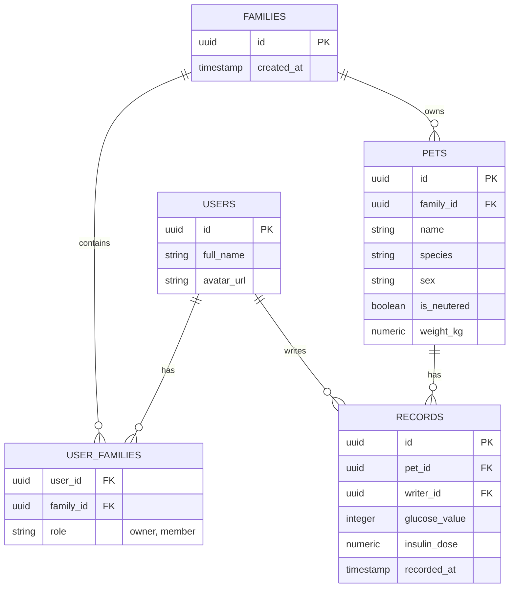

# Mettie App

반려동물 건강/당뇨 관리 애플리케이션입니다. 여러 마리의 반려동물을 다양한 가족 구성원(파트너)과 유연하게 공유할 수 있는 다중 사용자(Multi-tenant) 기반 아키텍처를 채택하고 있습니다.

## Database Schema (Supabase)

Mettie 앱의 핵심 데이터베이스 다이어그램입니다. 가족(그룹) 단위로 펫과 기록을 공유하기 위해 `user_families` 다대다(N:M) 테이블을 사용합니다.

