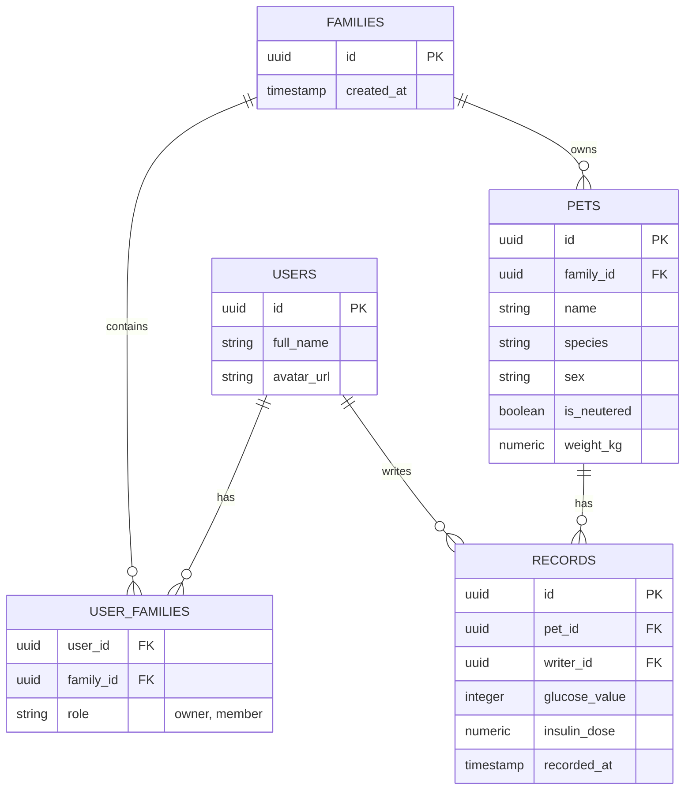

# Mettie App

반려동물 건강/당뇨 관리 애플리케이션입니다. 여러 마리의 반려동물을 다양한 가족 구성원(파트너)과 유연하게 공유할 수 있는 다중 사용자(Multi-tenant) 기반 아키텍처를 채택하고 있습니다.

## Database Schema (Supabase)

Mettie 앱의 핵심 데이터베이스 다이어그램입니다. 가족(그룹) 단위로 펫과 기록을 공유하기 위해 `user_families` 다대다(N:M) 테이블을 사용합니다.



## Troubleshooting

### Android: Google Play "16KB 메모리 페이지 크기 미지원" 오류

**증상**

Play Console에서 프로덕션 버전 생성 시 아래 오류로 App Bundle이 거부됨:

```
오류: 앱이 16KB 메모리 페이지 크기를 지원하지 않습니다.
16KB를 지원하지 않는 라이브러리: base/lib/arm64-v8a/libqdrant_edge_ffi.so
```

Google Play는 2025-11-01부터 Android 15+(API 35+)를 타겟하는 모든 앱 업데이트에
16KB 메모리 페이지 크기 지원(네이티브 라이브러리 ELF LOAD 세그먼트 16KB 정렬)을
강제한다. 이 앱은 온디바이스 LLM 추론에 `flutter_gemma`(MediaPipe/LiteRT-LM 기반)를
쓰는데, 이 플러그인이 번들링하는 일부 prebuilt 네이티브 라이브러리가 4KB 정렬로만
빌드되어 있어 정책을 위반했다.

**원인 분석**

빌드된 `app-release.aab`를 직접 풀어서 모든 `.so`의 ELF 프로그램 헤더 정렬을 검사
(`llvm-readelf -lW <file> | grep LOAD`, Android NDK의
`toolchains/llvm/prebuilt/<host>/bin/llvm-readelf` 사용)한 결과, 4KB로만 정렬된
파일은 다음 5개였다.

| 라이브러리 | 출처 | 비고 |
|---|---|---|
| `libqdrant_edge_ffi.so` | `flutter_gemma`의 on-device RAG 벡터스토어(Rust `qdrant-edge` crate) | flutter_gemma가 GitHub Release에서 직접 빌드/배포 |
| `libQnnHtpV73/75/79/81Skel.so` (4종) | Qualcomm QNN(Hexagon NPU) 가속 런타임 | Qualcomm이 배포하는 컴파일된 바이너리 — flutter_gemma가 직접 고칠 수 없음 |

이 앱은 `lib/data/repositories/llm_repository.dart`에서 `ModelFileType.litertlm`
모델만 사용하고, NPU 백엔드를 지정하지 않으며, `FlutterGemma.rag`(qdrant 벡터스토어)
API도 전혀 호출하지 않는다. 즉 위 5개 파일은 플러그인이 무조건 번들링하지만 이
앱은 실제로 쓰지 않는 네이티브 코드였다.

**해결**

1. **`libqdrant_edge_ffi.so`** — `flutter_gemma`를 1.0.0+로 업그레이드해서 해결.
   1.0.0부터 RAG/qdrant 지원이 opt-in 패키지(`flutter_gemma_rag_qdrant`)로 분리되어,
   이 패키지를 추가하지 않으면 해당 네이티브 라이브러리 자체가 번들에서 빠진다.
   (qdrant-edge 자체의 16KB 정렬은 `qdrant-edge-v0.7.3`부터 수정됨 — 참고:
   [DenisovAV/flutter_gemma#319](https://github.com/DenisovAV/flutter_gemma/issues/319))
   1.0.0의 모듈 분리에 맞춰 `flutter_gemma_litertlm` 패키지를 추가하고
   `FlutterGemma.initialize(inferenceEngines: [LiteRtLmEngine()])`으로 엔진을
   명시 등록해야 한다.
2. **`libQnnHtpV*Skel.so`** — Qualcomm이 배포하는 바이너리라 플러그인 업그레이드로는
   해결되지 않는다. `android/app/build.gradle.kts`의 `packaging { jniLibs { excludes } }`
   에서 직접 패키징 제외했다. 앱이 NPU 백엔드를 지정하지 않으므로 제외해도 기능
   손실은 없다(런타임에 자동으로 GPU/CPU 백엔드로 폴백).

**검증 방법**

```bash
flutter build appbundle --release
NDK=$(ls -d $ANDROID_HOME/ndk/*/ | tail -1)
RE="${NDK}toolchains/llvm/prebuilt/darwin-x86_64/bin/llvm-readelf"  # macOS 기준
unzip -q build/app/outputs/bundle/release/app-release.aab -d /tmp/aab_check
find /tmp/aab_check -iname "*.so" | while read f; do
  align=$($RE -lW "$f" | grep LOAD | head -1 | awk '{print $NF}')
  [ "$align" != "0x4000" ] && [ "$align" != "0x10000" ] && echo "MISALIGNED ($align): $f"
done
```

출력이 없으면(= `MISALIGNED` 없음) 모든 네이티브 라이브러리가 16KB 요구사항을
만족하는 것이다.
